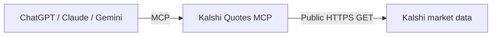

# Kalshi Quotes MCP

[](https://github.com/gordoaf/kalshi-quotes-mcp/actions/workflows/ci.yml)
[](LICENSE)

**Give your AI assistant one reliable way to check Kalshi prices.** A small,
read-only [Model Context Protocol](https://modelcontextprotocol.io/) server for
batch quotes, market rules, and order books. No Kalshi account or API key required.



- **Batch first:** up to 100 exact market tickers, normally one upstream request.
- **Precise prices:** decimal strings in cents, including fractional cents and sizes.
- **Honest snapshots:** missing liquidity, inactive markets, and retrieval times are explicit.
- **Two transports:** local stdio and remote Streamable HTTP, using the official Python MCP SDK.
- **Small scope:** four tools, no account access, trading operations, or price cache.

## Try it

Install [uv](https://docs.astral.sh/uv/getting-started/installation/) and
[Git](https://git-scm.com/downloads), then run:

```sh
uvx --from git+https://github.com/gordoaf/kalshi-quotes-mcp@v0.1.0 kalshi-quotes-mcp --check
```

The live diagnostic discovers two open markets, checks batch quotes, market details,
and an order book, then prints JSON. No credentials are involved. Python 3.11+ is
required; uv can provision Python if needed.

To work from a checkout:

```sh
git clone https://github.com/gordoaf/kalshi-quotes-mcp.git
cd kalshi-quotes-mcp
uv sync --locked
uv run kalshi-quotes-mcp --check
```

Without uv, on **Windows PowerShell**:

```powershell
git clone https://github.com/gordoaf/kalshi-quotes-mcp.git
cd kalshi-quotes-mcp
python -m venv .venv
.\.venv\Scripts\python.exe -m pip install .
.\.venv\Scripts\kalshi-quotes-mcp.exe --check
```

On macOS/Linux use `.venv/bin/python` and `.venv/bin/kalshi-quotes-mcp` instead.

## Connect a client

For clients accepting a local server definition:

```json
{
  "mcpServers": {
    "kalshi-quotes": {
      "command": "uvx",
      "args": [
        "--from",
        "git+https://github.com/gordoaf/kalshi-quotes-mcp@v0.1.0",
        "kalshi-quotes-mcp"
      ]
    }
  }
}
```

Use the full path to `uvx` if your desktop app cannot find it. A client with a
settings form takes the same command and separate arguments. You can also point
it directly at the executable in your checkout's `.venv` with no arguments.

| Client | Local installation | Shared remote server |
| --- | --- | --- |
| ChatGPT desktop | MCP server settings, stdio | Streamable HTTP |
| Claude desktop | Desktop MCP configuration | Custom connector |
| Gemini website | Cannot launch a local process | Custom app, eligible accounts |

**A Git installation does not make localhost reachable from Gemini's website.**
Use a publicly reachable HTTPS deployment or tunnel for remote clients. See
[client setup and troubleshooting](docs/clients.md).

Suggested project instruction:

> For Kalshi price checks, use Kalshi Quotes MCP. Batch known tickers in one
> get_quotes call. Report YES and NO bid/ask prices in cents and the retrieval
> time. Last trade is historical. Report unavailable quotes and failures
> explicitly. Do not substitute browser screenshots or remembered prices.

## Four tools

| Tool | Use | Example arguments |
| --- | --- | --- |
| `get_quotes` | Batch prices for 1–100 exact tickers | `{"tickers":["YOUR-MARKET-TICKER"]}` |
| `list_markets` | Discover a filtered page; not full-text search | `{"status":"open","limit":5}` |
| `get_market` | One market's prices, status, and rules | `{"ticker":"YOUR-MARKET-TICKER"}` |
| `get_orderbook` | Best-first bids, cheapest-first asks, sizes | `{"ticker":"YOUR-MARKET-TICKER","depth":10}` |

Start with `list_markets`, then use the returned exact tickers. Titles, event
tickers, and market tickers are different identifiers. `list_markets` accepts
`series_ticker`, `event_ticker`, `status`, `limit` (1–100), and `cursor`. It defaults
to open markets excluding combos; set `include_multivariate` to include them.
Reuse the same filters with `next_cursor` to continue.

## Read the prices correctly

- **Buy at ask; sell at bid.** Last trade is a separate historical observation.
- Price strings are **cents per contract**: `"43.25"` means 43.25¢, or $0.4325.
  Quantities are decimal strings in contracts. No binary-float price arithmetic.
- `null` is unavailable. Zero-size and 0/100¢ boundary quote values are suppressed
  conservatively; original upstream fields are retained as `raw_quote_fields`.
- `quote_state` is `available`, `partial`, `empty`, or `inactive`. Nonactive
  markets can retain historical bid/ask values. Available does not guarantee a fill.
- `last_trade_cents` is null when volume is zero. The API's last price does not
  supply an execution timestamp in this response.
- `retrieved_at` records receipt of the response, **not** the exchange quote time.
  Upstream `Date`/`Age` headers are included when present. `market_updated_at` is
  upstream market metadata, not a guaranteed timestamp for each quote.
- Each call fetches upstream; this server does not cache quotes. Kalshi may cache
  responses. Batch results are not a guaranteed atomic exchange snapshot.
- Quotes exclude fees and depend on the available size. Book asks are derived from
  opposite-side bids: a 40¢ NO bid implies a 60¢ YES ask of the same size.

Unknown tickers in a batch produce per-ticker `not_returned` errors without hiding
valid results. This does not prove a ticker never existed: older markets may be
archived. Order-book calls first confirm market existence, since Kalshi can return
an empty book for an unknown ticker.

## Serve over HTTP

```sh
kalshi-quotes-mcp --transport streamable-http --host 127.0.0.1 --port 8000
```

Endpoint: `http://127.0.0.1:8000/mcp`. For a remote host behind an HTTPS proxy:

```sh
kalshi-quotes-mcp --transport streamable-http --host 0.0.0.0 --port 8000 --allowed-host quotes.example.com
```

Connect clients to `https://quotes.example.com/mcp`. Repeat `--allowed-host` for
additional exact hostnames (optionally including a port). DNS rebinding protection
stays enabled. This is a public-data server with **no built-in client authentication**;
operators supply TLS, access restrictions if needed, ingress rate limits, and resource
limits. A hostname allowlist is not authentication. Never expose a private trading bot
through this endpoint.

Upstream requests are pooled, limited to four concurrent requests, and paced at five
requests per second **per process**. Adjust with `--requests-per-second` (maximum 20).
Transient errors get at most three attempts within a 30-second request deadline;
long `Retry-After` responses are surfaced rather than retried early. These are local
controls, not a guarantee of any Kalshi rate allowance.

### Docker

```sh
docker build -t kalshi-quotes-mcp .
docker run --rm -p 127.0.0.1:8000:8000 kalshi-quotes-mcp
```

For a public HTTPS proxy, append the HTTP flags including `--allowed-host` to
`docker run`. The proxy must preserve an allowed Host header. The container runs
as a non-root user. Docker is optional.

## Development

```sh
uv sync --locked --group dev
uv run pytest
uv run ruff check .
uv run ruff format --check .
uv build
```

Tests are offline and include MCP protocol calls over stdio and HTTP. `--check` is
the separate live API diagnostic. See [contributing](CONTRIBUTING.md) and
[security](SECURITY.md).

## Scope and sources

This project reads public prediction-market data. It cannot read your positions or
place, modify, or cancel orders. Kalshi's rate limits, availability, and terms apply;
self-hosting removes a separate MCP provider's allowance, not exchange limits.

- [Public market data](https://docs.kalshi.com/getting_started/quick_start_market_data)
- [Markets API](https://docs.kalshi.com/api-reference/market/get-markets)
- [Order-book semantics](https://docs.kalshi.com/getting_started/orderbook_responses)
- [Official Python MCP SDK](https://py.sdk.modelcontextprotocol.io/)
- [Kalshi's official hosted MCP](https://docs.kalshi.com/getting_started/mcp), an alternative
  if you prefer a provider-managed connector.

Independent project, not affiliated with or endorsed by Kalshi. [MIT licensed](LICENSE).
